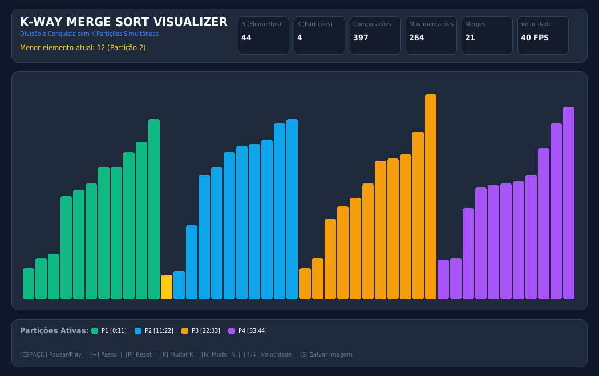
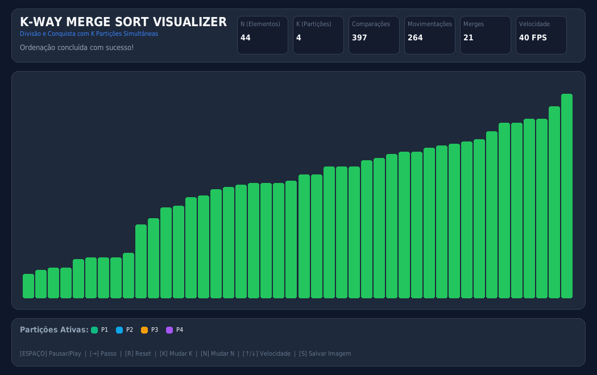
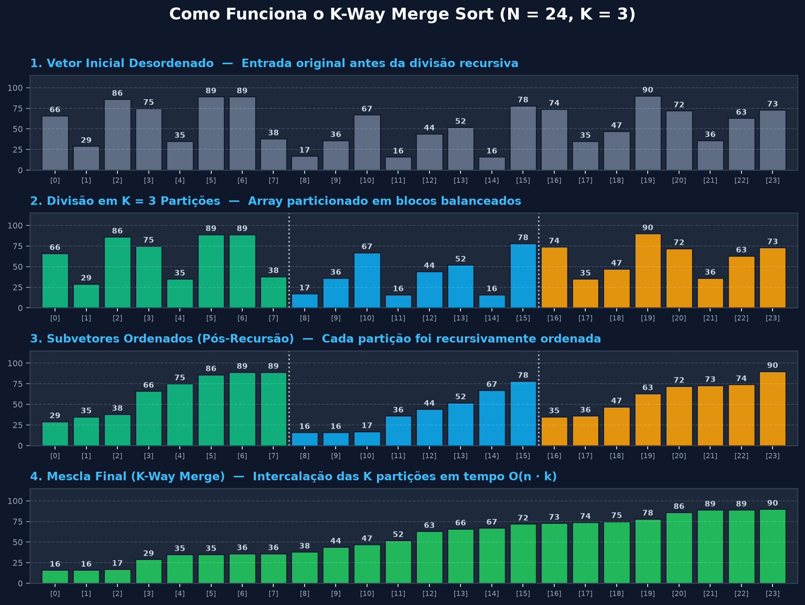
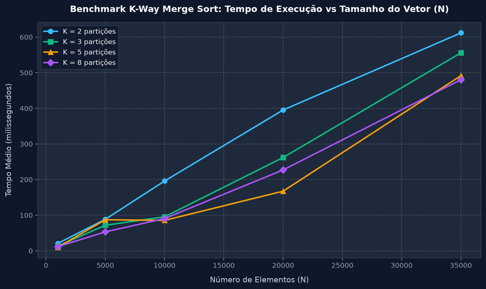

# 🚀 K-Way Merge Sort — Visualizer & Benchmark

<div align="center">


**Implementação e visualização interativa do algoritmo K-Way Merge Sort (Merge Sort com $K$ partições) em Python e C puro.**

</div>

---

## 📸 Interface Gráfica (Pygame)

Abaixo estão capturas de tela da interface visual interativa desenvolvida com **Pygame**, demonstrando a divisão das $K$ partições e o processo de intercalação (*merge*) em tempo real:

### 1. Intercalação ativa com $K = 4$ partições distintas
Cada partição recebe uma paleta de cor exclusiva para que a divisão recursiva e a seleção do menor elemento sejam evidentes:

<div align="center">
  
</div>

> **O que está acontecendo na imagem:** O intervalo ativo está dividido em 4 subvetores ordenados (Esmeralda, Azul, Âmbar e Roxo). O visualizador identifica o menor valor ativo entre as cabeças das 4 partições (destacado em amarelo) e o insere na posição mesclada de volta ao vetor.

---

### 2. Vetor final totalmente ordenado
Métricas completas de comparações, movimentações e quantidade de merges exibidas no HUD superior:

<div align="center">
  
</div>

---

## 🧠 Como Funciona o K-Way Merge Sort?

No **Merge Sort Tradicional** (binário), o vetor é sempre dividido em 2 metades ($K = 2$). 

No **K-Way Merge Sort**, generalizamos o paradigma de **Divisão e Conquista**:
1. **Divisão:** O vetor de tamanho $N$ é dividido em $K$ subvetores de tamanhos aproximadamente iguais ($N / K$).
2. **Conquista:** Cada uma das $K$ partições é recursivamente ordenada.
3. **Combinação (*K-Way Merge*):** Os $K$ subvetores já ordenados são intercalados simultaneamente, selecionando repetidamente o menor elemento disponível entre as cabeças ativas das partições.

<div align="center">
  
</div>

---

## 📊 Análise de Complexidade & Benchmark

### 1. Análise Teórica

A altura da árvore de recursão é reduzida para $\log_k N$. A complexidade depende da estratégia usada no merge:

| Estratégia de Merge | Complexidade por Nível | Complexidade Total de Tempo | Espaço Auxiliar |
| :--- | :---: | :---: | :---: |
| **Busca Linear entre as $K$ cabeças** (implementada aqui) | $O(N \cdot K)$ | **$O(N \cdot K \cdot \log_k N)$** | $O(N)$ |
| **Min-Heap / Fila de Prioridade de tamanho $K$** | $O(N \log K)$ | **$O(N \log N)$** | $O(N + K)$ |

> 💡 **Nota Teórica:** Conforme $K$ aumenta, a profundidade da recursão diminui, porém o custo de encontrar o menor elemento linearmente aumenta. Por isso, para valores pequenos de $K$ ($K=2, 3, 4$), o algoritmo mantém um desempenho extremamente competitivo, sendo fundamental no estudo de *External Sorting* (quando os dados residem em disco).

### 2. Benchmark Experimental (Python)

Gráfico gerado pelo script [`benchmark.py`](benchmark.py) medindo o tempo de execução real variando $N$ e $K$:

<div align="center">
  
</div>

---

## 💻 Como Executar

### Pré-requisitos
* **Python 3.10+**
* **GCC / Make** (opcional, para a engine em C)

### 1. Rodando a Interface Gráfica (Python + Pygame)

Clone o repositório e configure o ambiente:

```bash
# 1. Clone o repositório
git clone https://github.com/SEU-USUARIO/k-way-mergesort.git
cd k-way-mergesort

# 2. Crie e ative o ambiente virtual
python3 -m venv .venv
source .venv/bin/activate  # No Windows: .venv\Scripts\activate

# 3. Instale as dependências
pip install -r requirements.txt

# 4. Inicie o visualizador interativo
python3 visualizer_pygame.py
```

#### 🎮 Controles no Teclado:
| Tecla | Ação |
| :--- | :--- |
| `[ESPAÇO]` | Pausar / Continuar a animação |
| `[ → ]` | Avançar um único passo (modo passo-a-passo) |
| `[ R ]` | Reiniciar e gerar um novo vetor aleatório |
| `[ K ]` | Ciclar número de partições $K$ ($2 \to 3 \to 4 \to 5 \to 8$) |
| `[ N ]` | Ciclar tamanho do vetor $N$ ($24 \to 48 \to 80 \to 120$) |
| `[ ↑ / ↓ ]` | Aumentar / Diminuir velocidade (FPS) |
| `[ S ]` | Salvar screenshot da tela em formato `.png` |

---

### 2. Rodando os Gráficos Explicativos e Benchmark (Matplotlib)

```bash
# Gera o infográfico explicativo das 4 etapas
python3 visualizer_matplotlib.py assets/matplotlib_explanation.png

# Executa bateria de benchmark de tempo de execução
python3 benchmark.py assets/benchmark_comparison.png
```

---

### 3. Rodando a Versão em C Puro (Alta Performance)

O projeto mantém a implementação algorítmica original em C, modularizada com testes unitários automatizados e Makefile:

```bash
# Compilar e executar os testes unitários
make test

# Executar a ordenação de demonstração (N=30, K=4)
make run

# Executar benchmark em C com 100.000 inteiros
make benchmark

# Limpar arquivos de compilação
make clean
```

Exemplo de uso interativo via CLI em C:
```bash
./bin/mergesort -n 50 -k 4 -r
```

---

## 📁 Estrutura do Repositório

```text
k-way-mergesort/
├── assets/                       # Imagens de demonstração para o README
│   ├── pygame_merging.png
│   ├── pygame_sorted.png
│   ├── matplotlib_explanation.png
│   └── benchmark_comparison.png
├── src/                          # Código-fonte da engine em C
│   ├── mergesort_k.c
│   └── main.c
├── include/                      # Headers em C
│   └── mergesort_k.h
├── tests/                        # Testes unitários automatizados em C
│   └── test_mergesort.c
├── k_way_mergesort.py            # Módulo algorítmico e gerador em Python
├── visualizer_pygame.py          # Visualizador interativo em Pygame
├── visualizer_matplotlib.py      # Diagramas estáticos com Matplotlib
├── benchmark.py                  # Medição de tempos e geração de gráficos
├── Makefile                      # Automação de compilação e testes em C
├── requirements.txt              # Dependências Python (pygame, matplotlib, numpy)
├── .gitignore
└── README.md
```

---

## 📝 Licença

Distribuído sob a licença **MIT**. Consulte `LICENSE` para mais informações.
